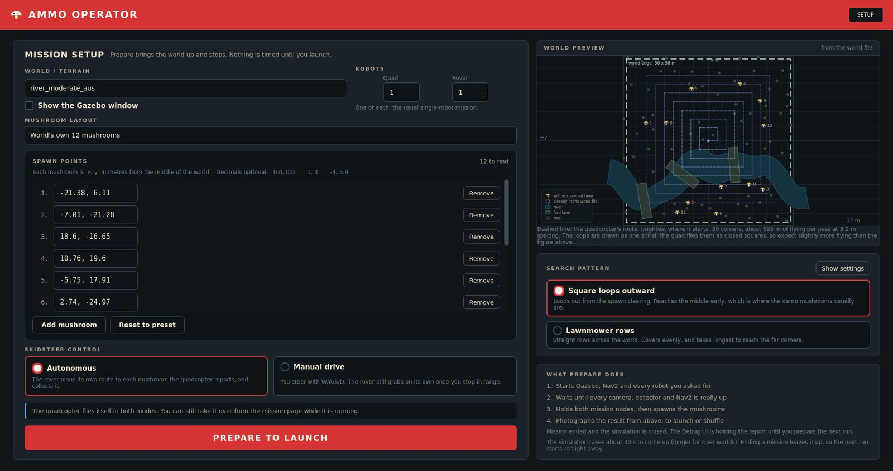
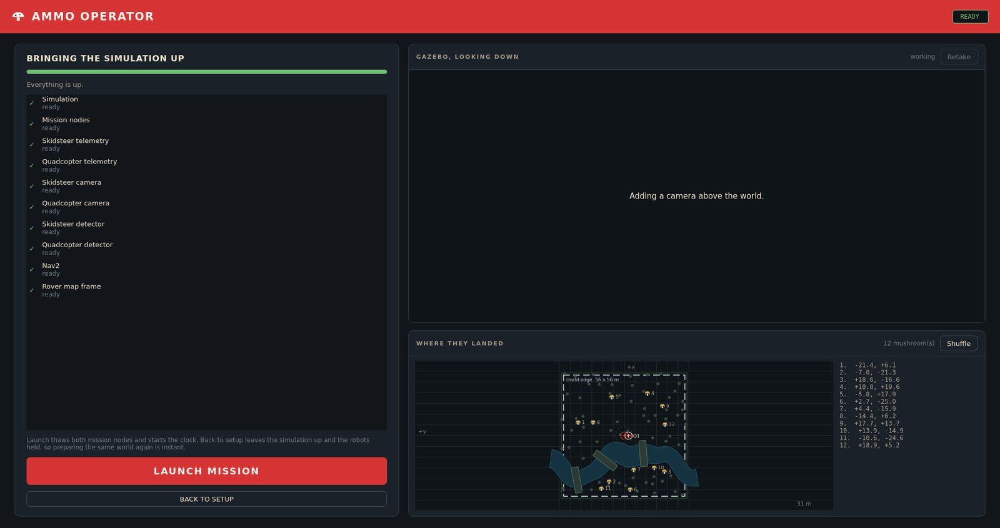
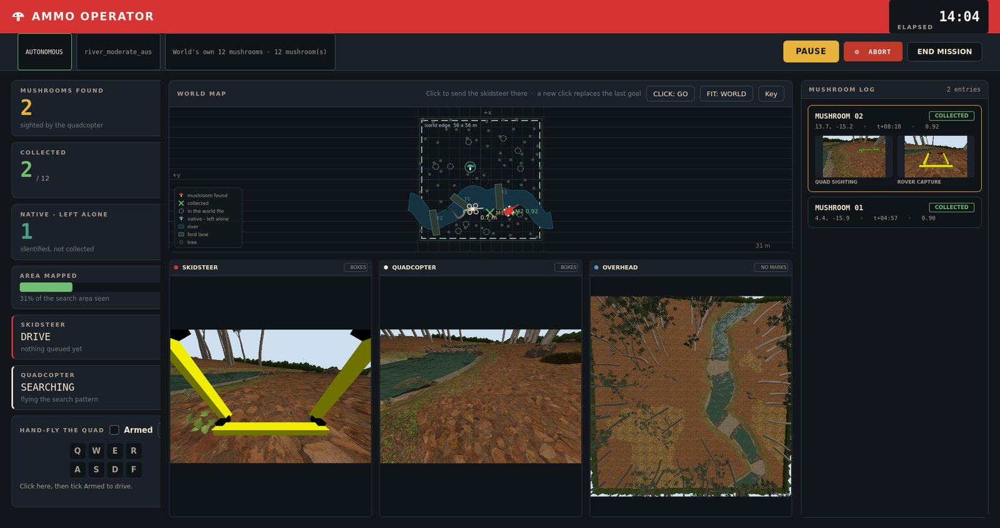
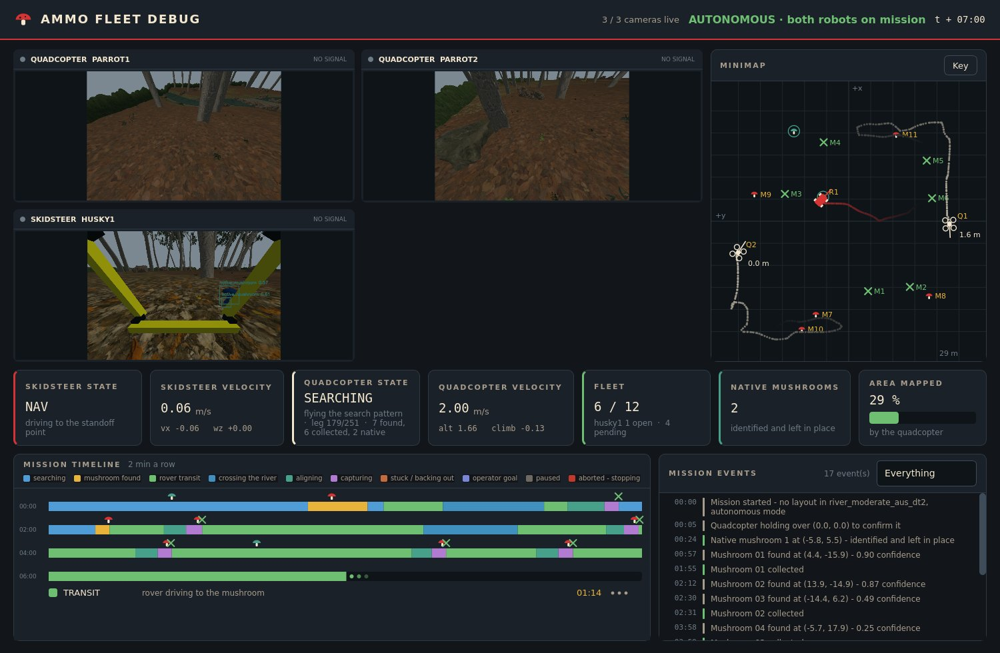

# ammo_gui_node

Danil's operator GUI and Debug UI. Two PySide6 windows plus a small bridge
node, all in this package. Separate from `ammo_dashboard` (Lachlan's OpenCV
HUD) - nothing here touches it, and both can run at the same time.

<div align="center">

 

*The setup page (left) and the ready page (right).*

 

*The mission page (left) and the Fleet Debug window (right).*

</div>

## One-time setup, per machine

```bash
sudo apt install -y git-lfs libxcb-cursor0 python3-scipy python3-pil
pip3 install torch==2.12.0 torchvision==0.27.0 ultralytics==8.4.66 openvino==2024.6.0 \
    PySide6==6.10.2 scipy "numpy<2"

cd ~/41068_ws/src/AMMO-Mushroom-Fleet
git lfs install && git lfs pull                 # see below - this is not optional
cd ~/41068_ws && colcon build --symlink-install   # AFTER the lfs pull, not before
```

`libxcb-cursor0` is what Qt 6.5+ needs for the xcb platform plugin. This
package itself needs only PySide6 and numpy - no OpenCV, since ROS images are
converted to Qt images with numpy (`image_utils.py`) - but the simulation it
starts needs the detector stack, and **nothing in the repo declares it**:
`perception/package.xml` lists rclpy, sensor_msgs, vision_msgs and cv_bridge
while `yolo_node.py` imports torch, cv2 and ultralytics, so `rosdep install`
cannot produce a working machine.

**Pin numpy below 2 and do it last.** `cv_bridge` and the Humble torch wheels
are built against the numpy 1.x ABI; `pip install ultralytics` installs numpy
2.x over the top, and the failure is not a version complaint but an
`ImportError` inside `cv_bridge` that never mentions numpy. The detectors
then never start, so nothing is ever detected and the checklist's two
detector rows never tick.

`tests/check_env.py` checks all of this and prints the command that fixes
each thing it finds.

**`git lfs` is not optional, and it is the one step people skip.**
`41068_ignition_bringup/.gitattributes` puts every `*.png`, `*.jpg`, `*.obj`
and `*.mtl` in Git LFS. Without `git-lfs` installed, a clone or pull writes
130-byte text pointers in place of the real assets - the mushroom mesh, its
texture, the tree bark, the terrain heightmaps, the pond and hedge meshes.
Gazebo loads such a model as an entity with **no geometry and no error**, so
the mushrooms spawn invisibly, the detector finds nothing, and every count
reads zero with nothing in any log to explain it. Check it worked:

```bash
ls -la 41068_ignition_bringup/models/mushroom_amanita/meshes/mushroom.obj
```

About **1.3 MB** is right. **130 bytes** means LFS has not run.

**Order matters.** `colcon build` copies `41068_ignition_bringup/models` into
`install/`, so a build done before `git lfs pull` leaves pointers in the
installed copy no matter how good the source tree looks. If in doubt,
`colcon build --packages-select 41068_ignition_bringup` again. The GUI warns
about this in the event log when it spawns, naming the file and the command.

## Running

The GUI starts the simulation itself. Close any Gazebo that is already
running first; Prepare refuses to start a second one.

**1. The operator GUI.** Starts the status bridge with it.

```bash
ros2 launch ammo_gui_node gui.launch.py
```

**2. The Debug UI.** Optional, read-only, open and close it whenever.

```bash
ros2 launch ammo_gui_node debug.launch.py
```

River worlds need `bash demo/get_world.sh` once; they only appear in the
world list after that.

> On WSL, if Gazebo dies a few seconds after Prepare with an Ogre or
> `GL3PlusTextureGpu` error, untick **Show the Gazebo window** on the setup
> page, or export `LIBGL_ALWAYS_SOFTWARE=1` before launching. The GUI watches
> for that specific crash and says so rather than leaving you with an empty
> mission page.

## Starting a run: Prepare, then Launch

A run starts in two stages, and almost everything awkward about the old
one-button Launch goes away as a result.

**Prepare** runs `cage_mission.launch.py` - Gazebo, Nav2, the z-camera quad,
`rover_capture_node`, `truth_localizer`, `collision_guard_node` and both YOLO
instances - or `fleet_mission.launch.py` if you asked for more than one of
either robot. **Every robot is held still from the instant Prepare is
pressed**, before a single node exists, so there is no window in which the
quadcopter can take off. The checklist fills in behind that, and when the
last piece arrives the mushrooms are spawned and the world is photographed
from directly above.

Holding uses the robots' own **`teleop_active` stand-down**, the same
heartbeat the PS4 controller sends: while it keeps arriving,
`rover_capture_node` and `zcam_quad_node` stop commanding their robot
entirely and, when it stops, re-plan from where they were left. That is much
better than stopping their processes - a standing-down node keeps its timers,
its clock and its Nav2 connection, and the quad goes on reporting sightings
the whole time. The GUI publishes zero velocity alongside the heartbeat,
because Gazebo's VelocityControl keeps the last command it was given forever.

**Launch** thaws those two processes and starts the clock.

Three things follow from the split, and they are the reason for it:

- The mission clock starts when the mission does. It used to start when the
  launch command returned and spend its first minute on Gazebo's start-up.
- The quadcopter has never seen the mushrooms when the run begins, because
  they are spawned after it is held. So you can look at where they landed,
  shuffle them, and look again, without giving anything away.
- A run that will not work says so before you have watched it for a minute.
  The checklist names what has not arrived, and Nav2 or a detector that never
  comes up is visible rather than looking like a robot that does nothing.

**Ending a mission stops everything**, including Gazebo, and then kills by
name anything that outlived its process group - Ignition re-parents its own
server and GUI, which is how a closed Gazebo window went on feeding camera
panels and why it sometimes took a reboot to clear. Keeping the simulation
between runs was faster, and it caused most of the trouble worth having: a
latched occupancy grid reading as a live coverage number that never moved,
phantom robots on the feeds, and a Prepare that refused to start because
something was already running.

The Debug UI keeps the run on screen instead - see the mission report below.

**Setup page.** Pick the world, pick or edit the mushroom layout, choose the
search pattern, choose Autonomous or Manual drive, set how many of each robot
you want, press Prepare. The capture tool is always the gripper now, so that
choice is gone.

A fleet is forced headless: two quadcopters means two YOLO instances and two
depth cameras, and Gazebo's own renderer on top of that is what left a world
that never finished loading. Every camera is in the GUI regardless. The
checkbox greys itself out as soon as either count goes above one and says so
on the page - it used to be a line in the log, so ticking the box and getting
no window read as a fault.

**The robot counts are real.** One of each runs `cage_mission.launch.py` as
before. More than one of either runs `quad_zcams/fleet_mission.launch.py`
instead - up to four quadcopters and five skidsteers, with their
`fleet_coordinator` handing mushrooms out between the rovers - and the
mission page grows a camera panel, a map marker and a state card per robot.
The ceilings are their launch file's own.

**Two worlds are offered**, because the team settled on two for the demo:
`simple_trees` and `river_moderate_aus`.

`simple_trees` lives in `41068_ignition_bringup/worlds/simple_trees.sdf` and
is in git, so it is on every machine. No ponds, no river, nothing to bog down
on, and it loads in seconds - the world to fall back to while something else
is being debugged.

`river_moderate_aus` is the mushroom demo world: a real river with three
rocky crossings, no ponds, Australian flora, and the only world the two-class
`amanita_river_v6` weights were trained against, so the only world where
native mushrooms can be detected at all. It is the world
`forest_worlds/demo_river.sh` runs. **It is not in git and never can be** -
`forest_worlds/.gitignore` excludes `worlds/`, `models/`, `world_assets/`,
`textures/`, `assets_src/` and `dem/`, so what is committed is the generator
scripts only. Each machine builds its own copy once:

```bash
cd src/AMMO-Mushroom-Fleet/forest_worlds && bash setup.sh      # internet, Blender >= 4.2
./view.sh moderate                                    # check it opens
```

The last line of `setup.sh`, `build_world.py --preset moderate --flora
australian`, is what writes `forest_worlds/worlds/river_moderate_aus.sdf`
alongside its `.meta.json`. Until that file exists the world is simply absent
from the dropdown, because `world_available` looks for it - which is why
whoever on the team has this world built it themselves.

`forest_flat`, `forest_random` and `large_demo` are off the menu. They still
resolve by name for their metas and map drawing if anything asks.

Layout presets are the world's own mushrooms (on a world that ships some),
whatever is in `layouts/<world>.json`, and **Random placement**, which puts
them clear of every solid thing in the world file - trees, fallen trees,
logs, stumps, rocks, debris and decoys, each by its own radius plus a margin
- outside the pond shores and the river, apart from each other and away from
the spawn clearing, and can be rolled again as often as you like. A crowded
world may not have room for as many as you asked for, and says so rather
than quietly giving you fewer. Every preset is editable: the coordinate
rows are the real list, and Prepare spawns exactly what is in them.

The preview beside the setup is drawn from the world's own `.meta.json` using
the same widget the live map uses, so a mushroom that would spawn inside a
pond is visible before you press Prepare rather than after.

**Ready page.** The checklist on the left fills in as each piece arrives:
Gazebo's clock, both mission node processes, both robots' odometry, both
cameras, both detectors, Nav2's action server, and the rover's `husky1_map`
frame on `/husky1/tf` (**not** `/tf` - every robot gets its own TF topic). On the right is the photo from above, the same placement drawn from
the world file, and the coordinates. Shuffle moves the mushrooms and
re-photographs; Retake just re-photographs; **Back to setup stops
everything.**

**Being on the setup page means nothing is running.** Back to setup and End
Mission both take the whole simulation down, and `shutdown` sweeps for
processes that outlived their group whether or not this GUI started them.
That used to be the other way round - the simulation was deliberately kept up
so a second Prepare on the same world was instant - and that single
optimisation is behind most of the confusing behaviour of the last three
runs: stale latched topics feeding camera panels for robots that were gone,
coverage frozen at a figure from a dead run, a leftover `ign gazebo` making
the next Prepare refuse quietly so the Launch button looked dead, and a
Gazebo window that would not close without a reboot. A slow second Prepare is
a much smaller price than a simulation nobody can account for.

Killing Ignition takes more than matching `ign gazebo` in a command line: the
server and the GUI end up as separate `ruby` processes whose command lines do
not reliably contain that string, which is why pattern matching alone left
windows alive. `kill_strays` now also walks every `ruby` process and reads
`/proc/<pid>/cmdline`, which is what `forest_worlds/view.sh` has always done
and what actually works.

**Each check is "has this arrived recently", not "has this ever arrived".**
That distinction is the whole correctness of the page. The record lives on
the bridge node, which outlives any one run, so an "ever" test meant the
second Prepare of a session started with the cameras and telemetry already
ticked - from the *previous* simulation's messages - and offered a Launch on
a world that had not finished loading. Every Prepare now clears that record
first, and a feed has to have delivered something within `FRESH_S` to count,
so a camera that dies mid-run is noticed instead of being remembered fondly.

If something never arrives, the button offers to launch anyway and says what
will be missing. Patience is measured from the last thing that arrived rather
than from the start - a river world takes far longer to come up, but in both
cases pieces keep arriving until the last one does, so forty-five seconds
with nothing new is a stall whatever the world. Launching anyway still
holds the nodes and spawns the mushrooms; it just does not wait for the
photo.

**Gazebo, the mission nodes and at least one camera are the checks it will
not waive.** The first two because without them there is no mission; the
camera because a run with no camera at all cannot detect a single mushroom,
so launching one is not a degraded run, it is a guaranteed empty one. When
the stall hits with a camera still missing the button says CANNOT LAUNCH YET
and the page explains it - including the thing that most often causes it,
which is the Gazebo window being ticked on a heavy world.

The photo needs a working camera in Gazebo. On software rendering it can
take a long time or never arrive, which is why there is a timeout and the
drawing underneath - the drawing has the same information in it.

**Search pattern** exposes the quad's own launch arguments: square loops out
from the spawn or lawnmower rows, the spacing between them, cruise speed and
height, whether to keep moving through corners, and whether to plan around
the world file at all. The defaults are the ones the team's launch file uses.

**Abort** is the emergency stop, beside Pause. The skidsteer halts, the
quadcopter lands where it is, and the timeline grows a dark red band with a
stop sign on it running from the moment you pressed it to the moment
everything actually came to rest - after which the clock stops. Resume hands
the robots back and starts the clock again; End Mission is beside it.

Landing is the GUI flying the quad down on `parrot1/agl` while holding the
stand-down, which is the state in which the quad's own node expects somebody
else to be flying it. Their `ammo/mission_complete` also lands a quad, with
full obstacle avoidance, but it flies home first - which an emergency stop
should not do.

**Mission page.** Everything here starts when you press Launch: the clock,
mushrooms found and collected counted separately, natives identified and left alone, how much of the area the
quadcopter has mapped, both robots' states, the map, both camera feeds, and
the mushroom log with a camera still per mushroom.

The cameras are a grid: every quadcopter, every skidsteer, and an
**overhead** feed from a camera the GUI spawns high above the world looking
straight down. It is the same camera that takes the Prepare photo, left
running. On software rendering it is a third rendered camera and costs
frames, so it can be turned off.

Controls are Pause/Resume, Abort, End Mission, clicking the map, and
hand-driving either robot. **MARK** on the quad panel asks the quadcopter to
send the mushroom in its view to the rover's queue - the quad answers with
its own gated sighting, so the projection is its own and not a guess made
here. The map click has two modes: **GO** sends the skidsteer there with a
Nav2 goal, **COLLECT** queues that point on `husky1/cage/waypoints` as
though the quadcopter had found it. Double-click a camera to fill the
window with it; Esc or a second double-click goes back.

Clicking the map suspends the rover's mission node, cancels whatever Nav2 was
doing and drives the rover to your point with its own Nav2 goal. The
quadcopter keeps flying and keeps reporting mushrooms while that happens.
When the rover arrives, its node is resumed and it goes back to the queue. A
second click replaces the first.

**Hand-driving.** Ticking *Armed* on a teleop panel suspends that robot's
mission node first, because two publishers on one velocity topic means the
robot obeys whichever message arrived last. The rover is W/S to drive and A/D
to turn, and goes through `collision_guard` so the guard can still veto
driving into a trunk. The quadcopter adds Q/E to slide sideways and R/F for
up and down, and goes straight to `parrot1/cmd_vel` - there is no guard in
front of it.

## The mission report

When a run ends, the Debug UI switches to a report rather than going quiet:
the counts, the whole timeline, the last overhead frame with **every
mushroom revealed and tagged** with what became of it - collected, gave up,
nothing there, never found - and a short read on what the numbers say and
which knob would change it.

It stays up until the next Prepare. The window dropping back to its waiting
banner with the cameras coming up one at a time is the visible proof that it
has picked up the new run, which was otherwise hard to tell.

## What the Debug UI does

Until a mission is launched, a banner across the top says which stage the
run is in - nothing running, preparing, or held and ready - and the
timeline, the event feed, the minimap's markers and the coverage figure stay
empty. The camera feeds and both robots' states and speeds are live
throughout, because during Prepare they are how you tell the simulation
really came up.

Once a mission starts: both camera feeds, large, showing the raw camera with the detector's boxes
drawn over it - red for an invasive amanita, teal for a native - so you can
see the classification live rather than at the detector's 2 Hz. The map, the
robots' states and velocities, the area mapped, the mission timeline at two
minutes a row, and the event feed.

The event feed is where every piece of trouble the rover reports ends up in
plain English: fords crossed, Nav2 legs stalled, places it got boxed in,
spots where the gripper closed on nothing, mushrooms it gave up on. Colour
tells you how much to care, and the filter hides everything that went fine.

It publishes nothing, so opening it mid-run is safe. The events topic is
transient-local, so opening it ten minutes in still draws the timeline from
the start.

## How it gets its data

Both mission nodes publish their own state now - `husky1/rover/state` and
`parrot1/quad_state` - so the GUI knows what the rover is doing and which of
the quadcopter's eleven phases it is in, rather than guessing from whether
the quad happens to be moving. See `integration/NOTES.md` for exactly what
was added to those two packages and why; it is three small additive changes,
and the bridge falls back to reading `/rosout` if they are ever removed.

`mission_bridge` consolidates those, plus `husky1/cage/waypoints`,
`husky1/cage/done`, `husky1/cage/missed`, `parrot1/ground_obstacles`,
odometry and `parrot1/detections`, into `ammo/mission/status` and
`ammo/mission/events`. Both windows read only those two topics.

### The search path, before you commit to it

The setup page draws the legs the quadcopter will fly, dashed, brightest at
the start and fading along the route, with a dot on the first corner. Both
patterns cover the same square, so the thing worth seeing is the *order*:
**square loops** work outward from the spawn in closed squares, so the first
mushrooms found are the rover's nearest, while **lawnmower rows** start at
one edge and sweep across. The note under the preview gives the corner count
and the metres flown per pass, which are not the same for the two patterns.

The rows are their route exactly. `search_preview.py` copies the arithmetic
out of `quad_search_node.build_lawnmower_waypoints`, and a test reads their
launch file, lifts the real function out of it and compares corner for
corner, so the lawnmower preview cannot drift from what the quad does.

The loops are the one deliberate exception: the preview draws **one
continuous spiral**, each arm longer than the last, while their
`_center_out` flies **closed squares** - every loop returns to the corner it
started at before stepping out to the next. The spiral is the clearer
picture of the idea and the arm spacing is the real lane width, so coverage
is honest even though the route is not; the note under the preview says so,
and `square_loops()` keeps their actual pattern, still tested. It sizes the
square the way `zcam_mission.launch.py` does
- the playable half-size less 4.5 m, or 6.5 m on a world with no meta, which
is why `simple_trees` draws one too. A test reads their launch file, lifts
the real lawnmower function out of it and compares corner for corner, so the
preview cannot quietly drift away from what the quad does.

## The map

Press **M** over either window, or click **MARKS** in the corner of the
overhead panel, to mark every mushroom and every robot on the overhead view.
Shape says what a thing is and colour says what is known about it, so neither
has to be read from hue alone: **mushrooms are circles** - red still out
there, amber sighted, green collected, grey given up on, purple gripped with
nothing in it - and **robots are squares**, teal for a quadcopter and blue for
a skidsteer, each with its number.

That button used to toggle detector boxes, which was useless on this panel:
the overhead camera has no detector attached, so there were never any boxes
to draw and clicking it appeared to do nothing.

The robots are not decoration. A robot is visible in the picture, so if its
square sits on it, the mushroom circles are in the right place too - it is a
free check on the projection every time you look. That projection is in
`overhead.py`: a straight-down, centred, flat camera is a scale and two sign
flips, and those two signs are the only thing that could be wrong. The
colour rules and the mark building live there too, so both windows share one
implementation instead of two that drift.

The **world edge** is drawn as a near-white dashed box with its size on it,
read from `world.playable_size_m`, and the map opens fitted to show all of
it. That matters because a Nav2 goal outside the playable area is rejected,
which from the operator's side looks exactly like the rover ignoring the
click; a click outside the box is now refused with a reason instead of being
sent. A world with no `.meta.json` has no box and allows everything.

Every robot gets its own marker and trail, labelled Q1, Q2, S1 and so on
once there is more than one of either.

**FIT** switches between the whole world and in close on the robots. Whole
world is the default, because it is the only way to see where you may click,
but a 60 m world makes the trees small - so the symbols are drawn brighter
and at a floor size when zoomed out, and one button gets the detail back.

Everything static is drawn from the world's `.meta.json` - the same file the
mission nodes read. Trees, fallen trees, logs, stumps, rocks, debris, ponds
and cleared lanes on a forest world; the river at its real width and the ford
lanes across it on a river world. The key lists only what the loaded world
actually has, so a forest run does not advertise fords.

On top of that go the live things: mushrooms found, collected, given up on
and grabbed-but-empty; natives left in place; where Nav2 gave up; where the
rover got boxed in; which fords it crossed; and the leg it is currently
driving.

## What is real, and what is a first pass

- Map, poses, trails, cameras, clock, counts, the mushroom log, the event
  feed, the timeline, coverage, both teleop panels and map goals are all
  wired to live data and work as described.
- **Pause** cancels the Nav2 goal, publishes zero velocity to both robots at
  20 Hz, and holds the mission nodes with the `teleop_active` heartbeat. That
  order matters: both robots use Gazebo's `VelocityControl` plugin, which
  holds its last command forever, so holding the nodes alone would leave them
  coasting. On resume the rover re-plans from where it was left.
- **Ending a mission takes the simulation with it.** It stands both robots
  down, removes the mushrooms the GUI spawned and stops Gazebo, Nav2 and the
  perception stack. It used to keep them up so a second run was instant; see
  the note above on why the setup page now means nothing is running.

### Why the mushrooms were invisible

They were not. They spawned every time - as real entities with no geometry on
them.

`models/mushroom_amanita/model.sdf` draws itself with
`model://mushroom_amanita/meshes/mushroom.obj`, and on this checkout that file
is **132 bytes of text**:

```
version https://git-lfs.github.com/spec/v1
oid sha256:41e34d8ffa2a8a6137083b92d5794edab336c59e5d95063e4e65e73ba025d340
size 1341217
```

`41068_ignition_bringup/.gitattributes` puts `*.png`, `*.obj` and `*.mtl` in
Git LFS, so without `git-lfs` installed a clone or pull writes a pointer that
merely names the real 1.3 MB asset. It has the right name and the right
extension, and no mesh loader can read it. `material_0.png` beside it is the
same, and so are the tree bark textures, the terrain heightmaps and the
native mushroom's cap texture.

The failure is silent by design. Gazebo Fortress spawns the model anyway -
`create` reports success, `ign model --list` lists it, the collision cylinder
is there and the rover could collect it - and draws nothing. So the
quadcopter's camera sees bare ground, the detector has nothing to detect, and
every count reads zero with no error in any log. Their own
`README_MUSHROOM.md` has it as the first row of its troubleshooting table:
"Mesh invisible, no error".

The fix is on the machine, not in the code:

```bash
sudo apt install -y git-lfs
cd ~/41068_ws/src/AMMO-Mushroom-Fleet && git lfs install && git lfs pull
```

`mesh_problem()` now checks the model file's mesh before spawning - absent,
or an LFS pointer - and says so in the event log along with that command, so
nobody has to spend another week on the detector.

Separately, **the launch now puts the bringup models on
`IGN_GAZEBO_RESOURCE_PATH`** for every world rather than only the river ones.
Nothing in the repo set it, which is why loading the river world by hand dies
with `Unable to find uri[model://mushroom_amanita]` before it finishes.

**Mushrooms are spawned by the GUI**, not by `mushrooms:=`, and they are
  spawned after the mission nodes are held. Spawn height is estimated from
  the world file's own objects, because `forest_random` rises over three
  metres and a mushroom spawned at z = 0 there is underground.
- **A world's own mushrooms can be taken out** - the generators name them
  `mushroom_00`, `mushroom_01`, ... and write the names into the meta - which
  is what lets Shuffle work on the river world and on the forest worlds. They
  do not come back until Gazebo restarts.
- **Snapshots** in the mushroom log are held in memory only. Closing the
  window loses them.
- **Box colours come from the weights' own class names.** The v6 model emits
  `amanita_muscaria_red` and `native_mushroom`; `DET_COLOURS` in
  `contract.py` lists both. Retrain with different names and every box goes
  back to the unknown-class blue until that dictionary is updated.
- **Native mushrooms** are wired end to end, but whether any appear depends
  on the weights the detector loads. The event feed says which classes it
  came up with, so if `native_mushroom` is not in that line the counter will
  sit at zero and that is the reason.
- No pan or zoom on the map - it auto-fits to the robots and the mushrooms
  and grows to keep them on screen. It deliberately does not fit the hedge
  boundary, which would shrink everything that matters to a few pixels.

### Three things the feed now says out loud

**"Mission started - every robot released from the hold"**, the moment Launch
takes effect. Then **"Quadcopter airborne at N m"**, once, when it actually
leaves the ground. Those are a minute apart, because the quad climbs to
cruise height before flying its first leg, and from the mission page that gap
looks exactly like Launch having done nothing.

**Marking from the ground is refused, with the reason.** Their quad only
keeps a sighting it can hand over once it has taken off -
`if msg.detections and self.taken_off` in `_det_cb` - so pressing MARK while
hovering at ground level sends a message nothing answers, however many boxes
the camera feed is drawing. A detection box and a sighting the quad will give
the rover are not the same thing, and that difference is invisible from here,
so the GUI says it.

**Touchdown during an abort**, the moment the quad reaches the ground, rather
than only at the end when the rover has also settled and the settle timer has
run. After an emergency stop, "it is down" is the one thing worth confirming
on its own.

## Testing

```bash
python3 src/AMMO-Mushroom-Fleet/ammo_gui_node/tests/run_tests.py
python3 src/AMMO-Mushroom-Fleet/ammo_gui_node/tests/run_tests.py --render
```

663 checks, a few seconds, no ROS, no simulation, no display and no built
workspace - `tests/stubs/` stands in for rclpy and the message types. The
`--render` flag also writes pictures of the setup page, the ready page
part-way through and finished, both windows, the Debug UI's held state and
the map into `tests/out/`, which is the quickest way to see what a change did to a layout.

One of those suites, `test_log_lines.py`, checks the lines the bridge reads
are still present in the mission nodes' source. If a teammate rewords one,
that is where you find out.
