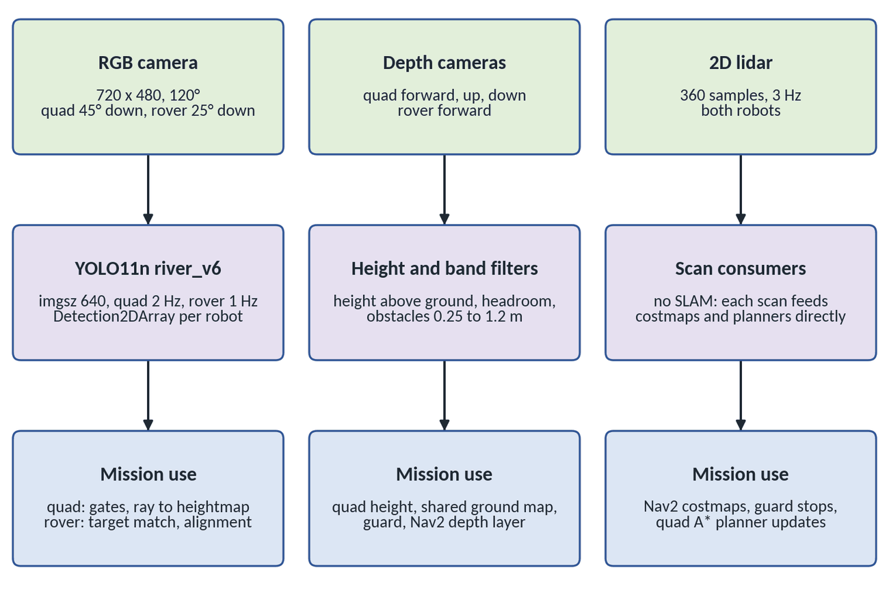

# perception

Detection for both robots.

In quad_zcams simulation, fleet_yolo_pool.py node (quad_zcams/quad_zcams/fleet_yolo_pool.py) is used, which optimises Yolo detections for use with a 
fleet of platforms. This is achieved using OpenVino and threading to create a seperate process for each Yolo detection stream, with priority management
for each stream to ensure its updated reguarly.

| File | Role |
|---|---|
| `yolo_node.py` | YOLO detector, one copy per camera. Publishes `<robot>/detections` and `<robot>/detections/image` |
| `hazard_brake.py` | Cancels the rover's Nav2 goal when a person fills the rover camera (about 3 m) |
| `combined_view.py` | One camera view with the mushroom and person detectors drawn together |
| `launch/perception.launch.py`, `launch/hazard_detection.launch.py` | Detector launches |
| `models/` | Trained weights. `variants/amanita_river_v6_yolo11n.pt` (invasive + native) is the demo model; `variants/README.md` lists the training history |

How each sensor feeds the mission:

