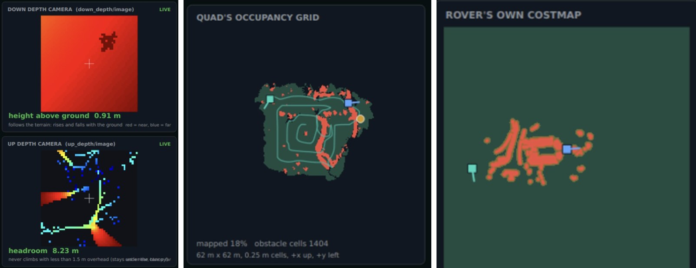

# Quadcopter Showcase

This is the display for the Quadcopter's occupancy maps and depth cameras to show off the mapping done. It will also show the complete quadcopter path and identified objects.
To run it, have the GUI up. This is done with:

```bash
cd ~/41068_ws && source /opt/ros/humble/setup.bash && source install/setup.bash \
&& export QT_QPA_PLATFORM=xcb && export LIBGL_ALWAYS_SOFTWARE=1 \
&& ros2 launch ammo_gui_node gui.launch.py
```

Then in a separate terminal:

```bash
ros2 launch ~/41068_ws/src/AMMO-Mushroom-Fleet/quad_showcase/quad_showcase.launch.py
```

There should be a 2nd window that opens showing the full outputs of the camera views. A snippet is shown below to demonstrate this:

<div align="center">



</div>


Thank you for using my Showcase :)

-Darcy
